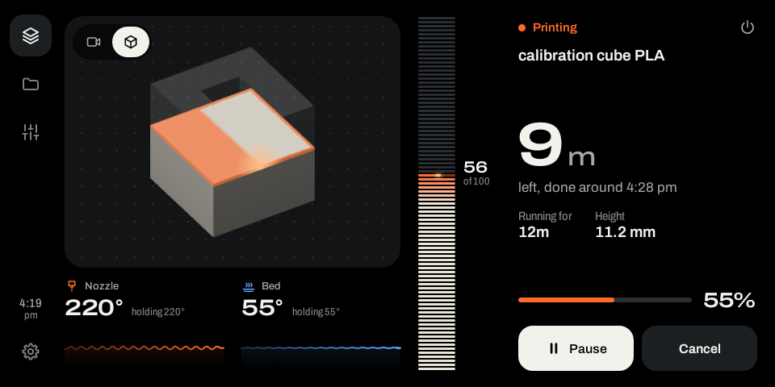
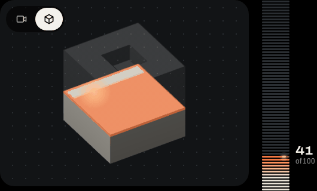
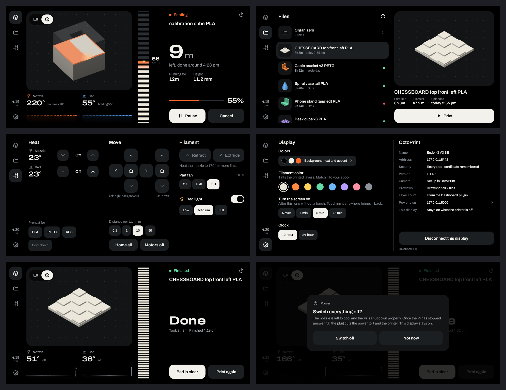
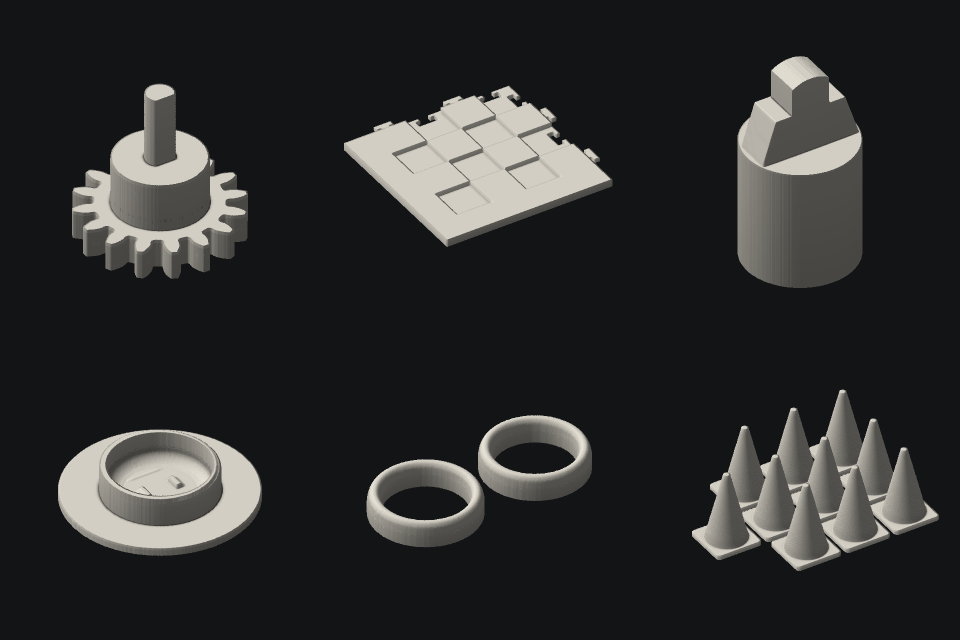
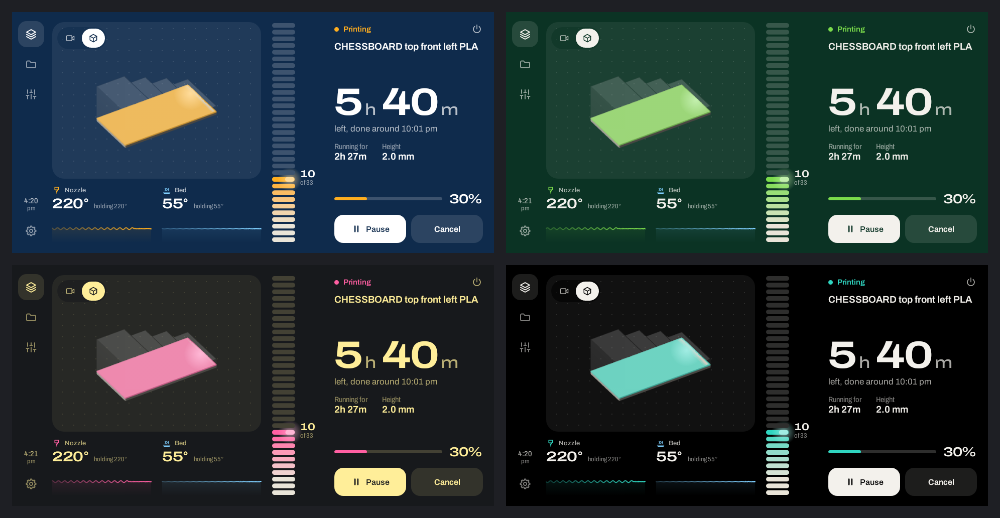

# OctoShow

An always-on touchscreen for a 3D printer, made from an Echo Show 5 and talking to
OctoPrint. It shows how the print is going, lets you start, pause and cancel jobs
without going to a computer, and can switch the printer and the Pi off properly
when you are done.



Once the display has read a job's G-code, the picture of the part stops being a
progress bar laid over a thumbnail. It draws the part as it stands, layer by layer,
and colors the top layer in the order the nozzle is laying it:



## What you need

- **An Echo Show 5 running Android.** This was built on a first-generation Echo
  Show 5 with LineageOS 18.1 (Android 11), installed by following
  [Goodbye Alexa, Hello Android (Install LineageOS on the Echo Show 5)](https://www.youtube.com/watch?v=5CCRIzcgKuM).
  Getting Android onto the device is outside this project. The app needs Android 11
  or newer and is laid out for the Echo Show 5's 960×480 screen; other devices are
  untested.
- **OctoPrint** on the same network. It was developed against 1.11 on OctoPi.
- **adb** on a computer, to install the app and for the one-time setup below.

Optional, and used when present:

| | What the display gets from it |
| --- | --- |
| Dashboard plugin | layer number and count, progress within the layer, fan speed, and the layer marks that let the top layer fill in along the nozzle's path |
| PrintTimeGenius plugin | a better time-remaining estimate (through OctoPrint's normal data) |
| Slicer Thumbnails plugin | the slicer's own previews in the file list |
| LightControls plugin | the light switch on the camera view and in Controls |
| A camera set up in OctoPrint, as an MJPEG stream | the live view |
| A smart plug running Tasmota, powering the printer and the Pi | switching everything off and back on |

None of these is needed. On a plain OctoPrint with no camera and no plugins the
display still shows the print, the time left and the temperatures, draws the part
growing by percentage, and starts, pauses and cancels jobs. Each extra is picked up
by itself when it is there, and anything that isn't simply doesn't appear: no camera
button without a camera, no light switch without lights, no power button without a
plug, no bed temperature for a printer without a heated bed. Settings lists what was
found and says where the rest would come from. In the app itself, the one thing
entered by hand is the smart plug's address.

## What it does



**Status** is the screen it lives on. From left to right: the part or the camera, a
stack of layers that grows as the print does, and how long is left. Pause is one
touch. Cancel has to be held for a moment, so a bumped screen can't end an
eight-hour print.

With the Dashboard plugin the layer stack is real data, not decoration. Each bar is
a layer (or several, once there are too many to tell apart), and the bead on the top
bar is how far through that layer the nozzle has got. Without the plugin the stack
fills by percentage.

**The part, as it is being printed.** While a job runs, the display fetches its
G-code once, slowly enough not to trouble the Pi, and from then on draws the part
only as high as it has been printed, inside a ghost of the finished shape. Until
that drawing is ready, and for files over 300 MB, which it leaves alone, it shows
the file's picture with a line rising up it. The layer on top fills in along the
nozzle's real path, in the order the slicer laid it: usually outlines first, then
the infill in whichever direction it runs, with a glow where the nozzle is. This
needs the Dashboard plugin, and the file has to have been uploaded while that plugin
was installed, because the plugin marks the layers as OctoPrint stores the file.
Without it the part rises by plain percentage.

**Files** lists the printable files in OctoPrint's own storage (not the printer's
SD card), folder by folder, newest first, with previews. Starting a print asks once,
reminding you to check the bed.

**Previews for every file.** When the Slicer Thumbnails plugin has pulled the
slicer's thumbnail out of a file, that is what the list shows. Otherwise the display
draws one itself: it reads the G-code, builds up the shape the extruded lines make,
and shades it like a slicer preview, in whatever filament color the display is set
to. Skirts, brims, supports and the purge line are left out when the slicer labels
them, as OrcaSlicer, PrusaSlicer, Cura and Bambu Studio do. These pictures are kept
on the display only. Nothing is written back to OctoPrint, so file dates and print
history are untouched.



**Controls** has heat (with the first four of OctoPrint's own temperature presets),
moving the head, extruding and retracting, the part fan and the light. While a job
runs, moving the head and feeding filament are locked, and the middle column becomes
speed and flow.

**Colors.** Background, text and accent are each chosen separately in Settings, and
the printed part is tinted to match the spool. The screen can go dark after 1, 5 or
15 minutes without a touch: black, with the backlight at its lowest, which is as far
as an app can take it. Touching it anywhere brings it back, and that first touch
does nothing else.



It also covers the moments that would otherwise send you to a browser:

- the printer asks a question, such as after a filament runout: the question and
  its answers appear on the display;
- a print finishes: it says so until you confirm the bed is clear;
- the printer is offline or has faulted: it says why, with a button to reconnect.

### Switching everything off

With a Tasmota plug set up, the power button in the corner of the status screen
switches the printer and the Pi off without pulling the power from under a running
Pi. It asks first, and the answer has to be held, not tapped. Then, in order:

1. It refuses if a print is running, or if OctoPrint isn't answering and so can't
   say whether one is.
2. The heaters are turned off and it waits for the nozzle to fall below 50°, so
   the hot end isn't left without its fan. If the nozzle hasn't cooled in twenty
   minutes, everything is left on.
3. OctoPrint is asked to shut the Pi down.
4. It waits until nothing has answered at the Pi's address for 30 seconds. A Pi that
   has halted can't say so, and silence is the nearest thing. Silence only counts
   while the plug still answers, which shows it isn't the display that has dropped
   off the network.
5. The plug cuts the power.
6. The display switches itself off too, if it has been allowed to (see below).

If the Pi is still answering three minutes after being told to shut down, the power
is left on and the display says so.

During a print the same button offers **Switch off when done**: once the job
finishes there is a 30-second pause, with a button to leave everything on, and then
the sequence above runs. A print that is cancelled or fails leaves everything on,
and so does restarting the app, which forgets the request.

Going the other way, an Echo Show that is started and finds the plug off switches it
on, within its first three minutes. So the Echo Show's own button is the master
switch: hold it to start the display, and the printer and the Pi come up with it. A
display that was left on shows a **Switch on** button instead.

## Putting it on the Echo Show

The commands on this page are written for the Windows command prompt. In PowerShell
write `.\gradlew`. On macOS or Linux write `./gradlew`, use forward slashes in
paths, and `export NAME=value` where this page has `set NAME=value`.

Switch on Android debugging in the Echo Show's developer options and check that it
shows up in `adb devices`. Then build the app and install it:

```
gradlew assembleDebug
adb install -r app\build\outputs\apk\debug\app-debug.apk
```

Building needs the Android SDK with platform 36, which Gradle finds through
`ANDROID_HOME` or a `local.properties` file naming `sdk.dir` (Android Studio writes
one for you), and a JDK to start Gradle with. Gradle fetches the rest, including the
JDK 21 it runs on.

Then, once:

```
adb shell cmd package set-home-activity com.drazan.echoshow.octoprint/.MainActivity
adb shell locksettings set-disabled true
```

The first makes OctoShow the home app, so the Echo Show starts straight into it. The
second removes the lock screen that would otherwise sit in front of it.

### First run

The display looks for OctoPrint on the network and lists what it finds. Touch
yours. OctoPrint then shows an access request from "OctoShow" to whoever is signed
in to its web page; choose Allow there. Do that signed in as an admin: the key gets
the rights of whoever approves it, and the light switch and shutting the Pi down
both need an admin's. That is the only step that needs another device, and it
happens once.

If nothing is listed, type the address (`octopi.local` or the Pi's IP). If you
would rather not approve a request, "I have a key" takes an application key copied
from OctoPrint's settings.

For unattended setup, a debug build also accepts the address and key over adb, and
the smart plug's address the same way:

```
adb shell am start -n com.drazan.echoshow.octoprint/.MainActivity --es url https://octopi.local --es key YOUR_KEY
adb shell am start -n com.drazan.echoshow.octoprint/.MainActivity --es plug 192.168.1.60
```

### The smart plug

In Settings, touch **Power plug** and give the plug's address. Two limits apply:

- It has to be a plug running Tasmota, reachable from the display and with no web
  password set. Other kinds of smart plug are not supported.
- The printer and the Pi both have to be powered through it. Switching off always
  shuts the Pi down first, so a Pi on its own power supply would be left halted,
  with nothing to start it again until it is unplugged and plugged back in.

OctoPrint also needs a shutdown command the display may use, which OctoPi sets up
by default.

### Letting the display switch itself off

Android doesn't let an ordinary app shut the device down, but it will do it for a
debugging session, so the display opens one to itself. That needs adb listening on
the display's own port 5555. With the plug already set up:

```
adb shell setprop persist.adb.tcp.port 5555
adb shell settings put global adb_allowed_connection_time 0
adb tcpip 5555
```

The first keeps adb on that port across restarts (it did on the LineageOS build used
here; other builds may want a root shell for it). The second stops Android forgetting
the approval after a week. The third takes effect now, and may drop your adb
connection; reconnect with `adb connect <the display's address>:5555` if it does.

Then restart the app and watch the display:

```
adb shell am force-stop com.drazan.echoshow.octoprint
adb shell am start -a android.intent.action.MAIN -c android.intent.category.HOME
```

Within a few seconds Android asks on the display whether to allow debugging: tick
**Always allow** and choose Allow. Settings then reads "This display: Goes off with
the printer". If you missed the question, touching the power button asks again.

Leave this out and everything else still works. The display simply stays on after
the printer and the Pi have gone off.

Be aware of what it means: anything on your network can open an adb session to a
device that listens on port 5555, though it has to be approved on the screen the
first time. Don't do this on a network you don't trust.

After the display has switched itself off, holding the Echo Show's top button for
about ten seconds starts it again.

## Before you rely on it

- **It can cut the power to your printer.** The switch-off sequence is careful, and
  its timing is covered by tests, but it controls a relay with your printer and Pi
  on the other side of it. Try it while you are standing there before trusting it
  to run after an overnight print.
- **There is no emergency stop.** The firmware this was built against ignores
  `M112`, and a button that can't deliver is worse than none. Cancel is the stop,
  and it is not instant.
- **It is no substitute for being near a running printer.** It shows what OctoPrint
  reports. It does not detect a failed print, a fire, or anything else OctoPrint
  doesn't know about.
- **It trusts your home network.** The Tasmota plug takes orders from anything that
  can reach it, and an OctoPrint served over plain http is spoken to in the clear.
- The software comes with no warranty of any kind; see the [license](LICENSE).

## How it talks to OctoPrint

- **An application key, not the global API key.** OctoPrint plans to remove the
  global key; the display asks for its own, which you can revoke under
  Settings > Application Keys, where it is listed as OctoShow. The key is sent to
  OctoPrint's own address and nowhere else, not even to another port on the Pi.
- **One push connection** for live state, the same one OctoPrint's own page uses.
  Printer state is pushed to the display, not polled.
- **https with the Pi's self-signed certificate.** The certificate met at setup is
  remembered and only that one is accepted afterwards. If the Pi is reinstalled the
  display says the certificate changed and asks to be set up again. https is tried
  first and plain http after it, because OctoPrint announces port 80 on the network
  even when only https answers.
- **By name.** Android 11 can't look up `.local` names, so the app does it itself.
  Set up by name, the display keeps working if the router gives the Pi a new address.
- **Gently.** The file list is megabytes on a well-used install and slow for a Pi
  to build, so it is cached and only re-fetched when it has changed, and never
  during a print unless the Files screen is open. Once the screen has gone dark,
  the camera stops. Drawing previews means downloading G-code, so the library waits
  for the printer to be idle and is then worked through one file at a time, newest
  first. During a print only the file being printed is fetched, held to about a
  megabyte a second.

## Things it deliberately doesn't do

- **No uploading or slicing.** Files arrive from the slicer as they do now.
- **No moving the head mid-print**, including while paused: OctoPrint doesn't put
  the head back where it was unless pause and resume scripts are set up to.
- **Nothing written to OctoPrint** beyond the commands you give it. Previews, colors
  and settings all live on the display.

## Working on it

There is no need for a device, or for a real printer, to see changes.

`gradlew :app:testDebugUnitTest` runs the tests. The ones for reading G-code, the
switch-off sequence and network discovery need nothing else. The rest drive the real
app against a stand-in OctoPrint, and are skipped when it isn't running.

That stand-in is `tools/mock-octoprint`: REST, the push socket, previews, G-code, an
MJPEG camera, a Tasmota plug, and a print that can be put into any state. It needs
Node, and `openssl` on the path to make itself a certificate for its https port. In
a terminal of its own:

```
cd tools\mock-octoprint
npm install
node server.js
```

It should say it is listening on http 5000 and https 5443; both ports are fixed, and
on a Mac the first is usually taken by AirPlay Receiver until that is switched off.
It answers this machine only. To point a real display at it, set `MOCK_HOST=0.0.0.0`
first, bearing in mind that it has a fixed key and takes orders from anyone.

With it running, from the repository root in another terminal:

```
gradlew :app:testDebugUnitTest --tests "*ScreenshotTest*"
```

runs the real app on the JVM against the mock, walks it through setup, a whole print
and switching off, and writes every screen at 960×480 to
`app/build/outputs/screens`. Gradle doesn't know the mock has started, so if it says
the tests are up to date, add `--rerun-tasks`.

`BareSetupTest` does the same against an OctoPrint with every optional part missing
at once: no camera, no plugins, no presets, no shutdown command, no heated bed, no
plug. The mock becomes one when asked, with `&without=camera,dashboard,...` on its
`/mock/set` address; the list is at the top of `server.js`.

For one screen in a hurry, or anything that moves, `SketchTest` goes straight to the
status screen and writes a run of frames to `app/build/outputs/sketches`. It needs
the mock too:

```
gradlew :app:testDebugUnitTest --tests "*.SketchTest" -Psketch=1
```

Two more look at real files, and are skipped unless pointed at some. The first draws
a preview for every G-code file in a folder, into `app/build/outputs/previews`. The
second takes one `.gcode` file as OctoPrint stored it, with the Dashboard plugin's
layer marks in it, and draws a layer filling in, into `app/build/outputs/sketches`.

```
set GCODE_SAMPLES=C:\path\to\gcode
gradlew :app:testDebugUnitTest --tests "*PreviewSamplesTest*"

gradlew :app:testDebugUnitTest --tests "*RealFileSketchTest*" -Psketch=C:\path\to\file.gcode
```

The pictures in `docs` came from these: the screens from `ScreenshotTest`, the
moving one from `SketchTest`, and the drawn previews from `PreviewSamplesTest`.

Two tests talk to the real network and are skipped unless asked for. Both only
read. One finds OctoPrint, connects, and asks questions that need no key; the other
only asks the network who is there.

```
set LIVE=1
gradlew :app:testDebugUnitTest --tests "*ConnectionTest*"

set MDNS_LIVE=1
gradlew :app:testDebugUnitTest --tests "*MdnsTest*"
```

### Layout of the code

```
app/src/main/java/com/drazan/echoshow/octoprint/
  octo/       OctoPrint itself: REST, push socket, camera, discovery, https trust,
              and drawing parts from G-code
  power/      the smart plug, the switch-off sequence, the display's own shutdown
  data/       what the display remembers between runs
  ui/         theme, components and the screens
  PrinterViewModel.kt   one server session: state in, commands out
```

## License and credits

OctoShow is released under the [MIT License](LICENSE). The Gradle wrapper that comes
with it (`gradlew`, `gradlew.bat` and `gradle/wrapper`) is Gradle's own, under the
Apache License 2.0.

The font is [Archivo](https://github.com/Omnibus-Type/Archivo), bundled so the
display looks the same whether or not the device has a font provider. Its license
is in `licenses/Archivo-OFL.txt`. The app is built with Jetpack Compose, OkHttp and
dadb; the tests use Robolectric and Roborazzi.

OctoShow is an independent project. It is not affiliated with, or endorsed by, the
OctoPrint project or Amazon. OctoPrint and Echo Show are trademarks of their
respective owners.
