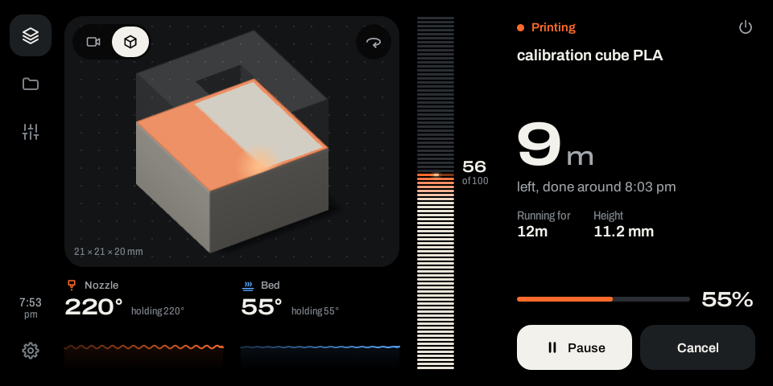
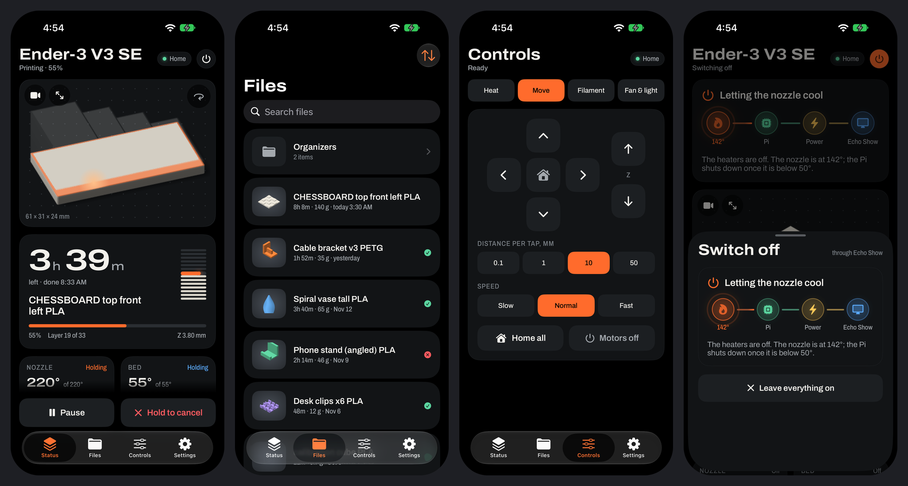

# OctoShow

Watch and run a 3D printer's [OctoPrint](https://octoprint.org) without going to a computer:
from an always-on screen beside the printer, from your iPhone wherever you are, or both.



Both show how the print is going and draw the part as it stands, layer by layer, with its real
infill, overhangs and supports, the top layer filling in along the nozzle's path. Both start,
pause and cancel jobs (cancel is held, never tapped), show the camera, and cover heat, moving
the head, feeding filament, the fan and the lights.



## Two apps, each on its own

| | [Echo Show display](android/README.md) | [iPhone](ios/README.md) |
| --- | --- | --- |
| What it is | An Echo Show 5 running Android, turned into a touchscreen that lives by the printer | An app for your phone |
| Where it works | At home, always on | At home, and away over Tailscale, a Cloudflare Tunnel or a relay |
| Only this one | Switches the printer and the Pi off safely through a Tasmota smart plug, and back on | Alerts through ntfy when a print finishes, fails or pauses, with the app closed |
| Together | Takes "switch off" from the phone and runs it | Asks the Echo Show to switch everything off, from home or away, with the OctoShow plugin |
| Put on with | adb, from any computer | Xcode, on a Mac; a free Apple account will do |

Neither needs the other. Each talks to OctoPrint itself, with an application key of its own.
With both, and the small [OctoShow plugin](octoprint-plugin/README.md) in OctoPrint, the phone can
ask the Echo Show to switch everything off, and follow along as it does.

## What you need

**OctoPrint** on your network. Both apps were developed against OctoPrint 1.11 on OctoPi.

Everything else is optional. Each app picks up what is there and leaves out what isn't: no camera
button without a camera, no light switch without lights.

| Optional | What it adds | Echo Show | iPhone |
| --- | --- | :---: | :---: |
| Dashboard plugin | layer number and count, progress within the layer, fan speed, and the layer marks that let the top layer fill in along the nozzle's path | yes | yes |
| PrintTimeGenius plugin | a better time-remaining estimate | yes | yes |
| Slicer Thumbnails plugin | the slicer's own previews in the file list | yes | yes |
| LightControls plugin | the light switch | yes | yes |
| A camera, as an MJPEG stream | the live view | yes | yes |
| A Tasmota smart plug powering the printer and the Pi | switching everything off and back on | yes | through the Echo Show |
| The [OctoShow plugin](octoprint-plugin/README.md) | switching off from the phone, through the Echo Show | yes | yes |
| Firmware that reports the nozzle's real position | the part drawn where the nozzle really is | yes | yes |

## What's where

```
android/                 the Echo Show display (Kotlin, Jetpack Compose)
ios/                     the iPhone app (SwiftUI)
  Packages/PartKit/      drawing the part from its G-code, ported from the display
octoprint-plugin/        the OctoShow plugin, which carries "switch off" from the phone to the display
tools/mock-octoprint/    a stand-in OctoPrint that both apps are tested against
docs/                    pictures for the READMEs
```

Neither app needs a printer, or a device, to be worked on. The stand-in OctoPrint plays a whole
job, the plugins, a camera and the smart plug, and each app's README says how to try it against
it.

## Before you rely on it

OctoShow shows what OctoPrint reports. It does not detect a failed print, a fire, or anything
else OctoPrint doesn't know about, and it is no substitute for being near a running printer. The
Echo Show display can cut the power to your printer; read [what it does first](android/README.md#switching-everything-off).

## License and credits

OctoShow is released under the [MIT License](LICENSE), with no warranty of any kind. The Gradle
wrapper in `android/` (`gradlew`, `gradlew.bat` and `gradle/wrapper`) is Gradle's own, under the
Apache License 2.0.

The font is [Archivo](https://github.com/Omnibus-Type/Archivo), bundled in both apps so they look
the same everywhere. Its license is in [`licenses/Archivo-OFL.txt`](licenses/Archivo-OFL.txt).

OctoShow is an independent project. It is not affiliated with, or endorsed by, the OctoPrint
project, Amazon or Apple. OctoPrint, Echo Show and iPhone are trademarks of their respective
owners.
